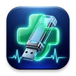

# USB Doctor AI

**Intelligent Storage Diagnosis, Repair & Recovery Suite**

Desktop application for Windows 10/11 and macOS (Intel + Apple Silicon) that diagnoses USB
flash drives, memory cards, external disks and supported internal drives using the real
hardware APIs of the operating system — no simulated results, no fabricated health scores.

<p align="center">
  
</p>

---

## What it actually does

| Capability | How it works |
| --- | --- |
| **Device identification** | PowerShell `Get-Disk`/`Get-Partition`/WMI, `lsblk`, `diskutil` + IOKit, raw USB descriptors (VID/PID/serial, negotiated link speed) |
| **Health verdict** | SMART attributes via `smartctl`, confirmed surface read errors, file-system structure validation, capacity verification — every finding carries its evidence code |
| **Repair** | File-system **metadata only**: FAT32 boot-sector restore from the on-disk backup, exFAT boot-region/checksum rebuild, NTFS boot-sector repair, FAT mirror/FSInfo rebuild, GPT backup header rebuild, partition-table reconstruction |
| **Data recovery** | Resumable sector imaging (built-in + optional GNU ddrescue), FAT12/16/32 + exFAT walker with long filenames and deleted entries, signature-based content carving (15 formats) |
| **Performance** | Per-block read benchmarking spread across the address space, rated against the device's real negotiated interface; counterfeit-capacity detection by write→read-back verification |
| **Diagnosis** | Curated knowledge base of error codes and failure modes + deterministic assistant that explains the measured evidence and can only *order* operations the safety planner already approved |

### Which devices it can actually repair

"Repair" here means **rebuilding file-system metadata from authentic on-disk sources** — the
backup boot sector, the redundant FAT, the GPT backup header. That fixes the drives that fail
most often: ones whose data is intact but whose bookkeeping was corrupted by a pulled cable, a
power cut, or a bad unmount. It does not and cannot rebuild data that is physically gone.

| Storage device | Diagnose | Repair metadata | Recover files |
| --- | --- | --- | --- |
| USB flash drive, FAT32/exFAT (most sticks) | yes | **yes** — boot region, FSInfo, FAT mirror | yes, incl. deleted files |
| USB flash drive, NTFS | yes | **yes** — boot sector from backup | carving only |
| Memory card (SD/microSD), FAT32/exFAT | yes | **yes** | yes, incl. deleted files |
| External/internal HDD/SSD, NTFS/FAT/exFAT | yes | **yes** — repairs target the volume, so the partition table is never touched | yes (FAT/exFAT), carving (NTFS) |
| External HDD/SSD, ext2/3/4 | yes | **no** — routed to `fsck` (`native-repair`) | carving only |
| External drive, APFS / HFS+ | yes | **no** — routed to `diskutil repairVolume` (macOS) | carving only |
| Windows/Linux boot disk, any layout | yes | **refused by policy** (system disk) | yes |
| Any device with confirmed media damage | yes | **no repair offered** — advises replacement and recovery only | yes |
| Counterfeit (fake-capacity) drive | yes | **no** — capacity is a lie; only recovery helps | yes |
| Dead controller / drive not enumerating | **no** — the OS cannot see it | no | no |

Repairs are applied **inside the volume that was diagnosed**, never at LBA 0. A disk with a
partition table keeps that table byte-for-byte: only the file system's own metadata is
rewritten. That distinction is what makes repairing an SSD or hard disk safe — and it is
covered by tests that assert the MBR is unchanged after every repair.

`ext4`, `APFS` and `HFS+` are diagnosed by this app but repaired by the platform's own tool,
after explicit consent, because hand-writing journaled metadata is how you lose data. If that
tool is missing, the app says so and stops; it does not substitute a guess.

When the outcome is "this cannot be fixed in software", the app says that plainly and points
at data recovery instead of offering a repair that would waste your time or your data.

### What it will never do

- It will not claim to repair physically damaged NAND, worn-out flash or a dead controller.
- It will not produce a health percentage from data the device does not provide — it says **unavailable**.
- It will not format, erase or flash firmware automatically. There is no code path that does.
- It will not write to a device without a single-use, path-bound, signature-bound consent token.
- It will not write recovered files onto the source device.

---

## Install

### Windows 10/11

Download `USBDoctorAI-Setup-1.0.0.exe` and run it. The installer is **fully
offline**: it contains Python, Qt and the whole application, so no internet
connection is needed to install or to run.

Run the app as administrator — raw device access and SMART queries require
elevation.

Prefer no installation? `USBDoctorAI-1.0.0-portable.zip` is the same program,
unpack and run `USBDoctorAI.exe`.

### macOS 11+

Download the disk image for your Mac — `USBDoctorAI-1.0.0-arm64.dmg` for Apple
Silicon or `...-x64.dmg` for Intel — open it, drag **USB Doctor AI** to
*Applications*, then launch it. Fully offline, like the Windows installer.
macOS asks for permission the first time the app reads a removable volume — allow it.

### From source (any platform)

```bash
git clone https://github.com/Analoggeek/DriveRepair.git
cd DriveRepair
python -m venv .venv && . .venv/bin/activate       # Windows: .venv\Scripts\activate
pip install -e ".[desktop]"                        # PySide6 for the desktop UI

usbdoctor-gui                 # desktop app
usbdoctor devices             # CLI (works with no GUI and no extras)
usbdoctor serve --open        # local web interface
```

The engine, the CLI and the web interface need **only the Python standard library**.
PySide6 is required for the desktop window alone.

---

## Quick start

1. **Launch** the app (elevated on Windows).
2. Plug in the drive. It appears on **Devices** with its real identity.
3. Press **Scan & Repair Automatically** — this runs a read-only scan and then offers *only*
   the repairs that are low-risk and backed by evidence. You still confirm in the dialog.
4. If files are missing, go to **Data Recovery**: image the drive first, then recover from
   the image. The source device is opened read-only.

### Three modes

| Mode | Planned operations |
| --- | --- |
| **SAFE** | Read-only checks and diagnostics only |
| **SMART REPAIR** | Adds low-risk metadata repairs that rebuild from on-disk copies |
| **ADVANCED** | Adds medium/high-risk operations; each one needs its own confirmation |

---

## The 10-step workflow

Every scan follows the same order, and the UI shows which step is running:

1. Detect the device and read its identity
2. Identify controller, interface and real capacity
3. Scan metadata and surface for errors
4. Analyse error codes against the knowledge base
5. Research this exact model on official sources (allow-listed domains only)
6. Compare repair procedures and pick the safest
7. Back up / image the device before any write
8. Apply only verified-safe repairs
9. Verify the result by re-reading and re-checking
10. Produce the report

---

## Command line

```bash
usbdoctor devices                       # list drives
usbdoctor status                        # platform, rights, detected tools
usbdoctor scan /dev/sdb --watch         # read-only scan with live progress
usbdoctor scan /dev/sdb --report ./report   # also write .md / .json / .html
usbdoctor plan /dev/sdb --mode advanced # what could be repaired, with risk
usbdoctor repair /dev/sdb --approve     # asks before writing (exit 2 without --approve)
usbdoctor image /dev/sdb backup.img     # resumable sector image
usbdoctor recover /dev/sdb --out ./files
usbdoctor capacity /dev/sdb --approve   # counterfeit drive check
usbdoctor report /dev/sdb --format html --out report.html
```

Exit codes: `0` success · `1` error · `2` refused for safety · `3` cancelled by the user.

---

## Architecture

```
usbdoctor/
├── core/           device model, raw I/O, platform detection, errors, events, audit log
├── security/       safety policy, consent tokens, writer guard (identity re-verification)
├── analysis/       partition tables, FAT/exFAT/NTFS/ext validation, SMART, surface probe, health
├── devices/        per-platform enumeration (Windows PowerShell/CIM, Linux sysfs, macOS diskutil)
├── repair/         operation registry, evidence→plan planner, executor, rollback, verifiers
├── recovery/       resumable imaging, content carving, FAT/exFAT file recovery
├── performance/    read/write benchmarks, capacity verification
├── knowledge/      curated error-code database + allow-listed HTTPS research
├── ai/             deterministic diagnostic assistant (cannot invent or execute repairs)
├── db/             SQLite history (scans, repairs, recoveries, settings)
├── service/        one orchestration point shared by GUI, CLI and API
├── webapi/         stdlib WSGI REST + SSE server
├── frontend/web/   10-page dark/light UI (no build step, no CDN)
├── app/            PySide6 desktop application
└── cli.py          command-line interface
```

The GUI, the CLI and the web API all call the same `DoctorService`, so a safety rule can
never diverge between frontends.

---

## Tests

```bash
python -m pytest tests -q          # 209 tests
```

The suite builds real FAT32, exFAT, NTFS and ext images and performs genuine damage +
repair cycles: destroy a boot sector, scan, approve, repair, verify the bytes, and read the
original file back out. Security invariants are tested too — consent tokens are single-use
and device-bound, and a swap of the media is detected before a write.

---

## Building installers

```powershell
powershell -ExecutionPolicy Bypass -File installers\windows\build.ps1
```

```bash
./installers/macos/build.sh              # add --sign to sign + notarize
```

See `docs/developer/BUILD.md` for signing, notarization and release steps.

---

## Documentation

- [`docs/user/USER_MANUAL.md`](docs/user/USER_MANUAL.md) — every screen and control
- [`docs/user/TROUBLESHOOTING.md`](docs/user/TROUBLESHOOTING.md) — when things go wrong
- [`docs/developer/ARCHITECTURE.md`](docs/developer/ARCHITECTURE.md) — module map and data flow
- [`docs/developer/BUILD.md`](docs/developer/BUILD.md) — packaging, signing, notarization
- [`docs/developer/SAFETY.md`](docs/developer/SAFETY.md) — the safety contract in code

---

## Licence

Proprietary — see [LICENSE](LICENSE). Diagnose and recover at your own risk, and keep
independent backups of anything irreplaceable.
